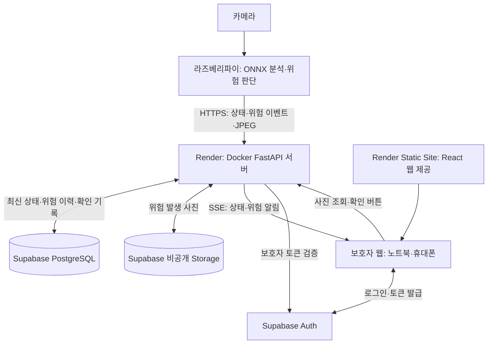
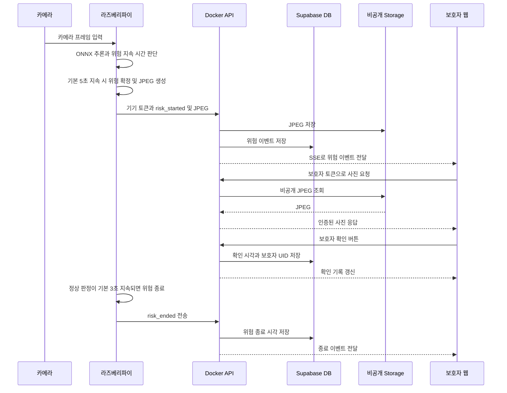
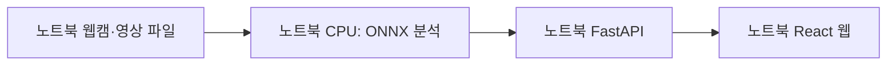

# 아가 아이 작동 구조

기준: 2026-10-19, 기능별 PR에 올라간 구현 코드. **아래는 배포 후 사용할 연결 구조이며, 실제 Render·Supabase 프로젝트·라즈베리파이 연결은 아직 검증 전입니다.**

모델 데모·클라우드 API·보호자 웹·파이 배포 기능을 함께 연결한 전체 구현 기준입니다. 기능별 PR과 main 통합 관계는 [PR 안내](PR_GUIDE.md)에서 확인합니다.

핵심 역할은 **파이에서 분석 → 클라우드에서 저장·전달 → 보호자 웹에서 확인**입니다.

## 1. 전체 구성

| 위치 | 담당하는 일 |
| --- | --- |
| 카메라 | 라즈베리파이에 프레임 입력 |
| 라즈베리파이 | ONNX 추론, 자세·코입 상태 해석, 위험 지속·종료 판단, 상태·이벤트·JPEG 전송 |
| Render Docker API | 기기·보호자 인증, 상태 수신, 영구 저장, 실시간 전달, 확인 기록, 연결 끊김 판단 |
| Supabase PostgreSQL | 기기 최신 상태, 위험 이벤트, 보호자 확인, 알림, 설정 저장 |
| Supabase Storage | 위험 발생 시 JPEG 파일 보관. 비공개 버킷 사용 |
| Supabase Auth | 보호자 로그인·세션 토큰 발급. API가 토큰을 검증 |
| Render Static Site | 웹 화면 파일을 제공. React는 보호자 브라우저에서 실행 |
| 보호자 브라우저 | 현재 상태·알림·위험 사진·이력 표시, 보호자 확인 요청 |

모델은 파이에서 실행합니다. 클라우드에는 상태와 위험 발생 JPEG를 전송하며 연속 영상은 업로드하지 않습니다. 사진은 로그인한 보호자가 API를 통해 조회합니다.

## 2. 위험 발생부터 보호자 확인까지

기본 엣지 설정은 초당 약 3회 추론, 위험 확정 5초, 정상 확인 후 종료 3초입니다. 실제 처리 속도는 장치 성능에 따라 달라지며 짧은 탐지 공백을 허용하는 설정도 적용합니다. 위험 이벤트 전송은 발생 시 바로 시도하고, 전송 실패 시 큐에서 재시도합니다. 인터넷 상태와 무료 서버의 대기 상태에 따라 도착 시간이 늦어질 수 있습니다.

**확인 버튼은 위험을 종료시키지 않습니다.** 보호자가 확인했다는 기록을 저장하며, 실제 위험 종료는 파이의 분석 결과로 별도 전달됩니다.

## 3. 일반 상태·연결·인증

| 항목 | 현재 구현 |
| --- | --- |
| 파이 생존 신호 | 기본 5초마다 최신 상태를 API에 전송 |
| 위험 이벤트 | 발생 시 전송 시도. 생존 신호 주기를 기다리지 않음 |
| 파이 연결 끊김 | API가 20초 동안 생존 신호를 받지 못하면 오프라인 처리 |
| 분석 결과 갱신 중단 | 웹은 12초가 지난 분석을 현재 정상으로 표시하지 않음 |
| 서버 연결 | 브라우저의 API·SSE 통신 상태로 표시 |
| 카메라 상태 | 처리된 프레임 시각과 명시적인 입력 오류·중지 상태를 기준으로 표시 |
| 아기 존재·위험 여부 | 모델 결과와 입력의 최신성을 함께 확인. 미감지·어두움·단절은 정상과 구분 |
| 보호자 인증 | 브라우저가 Supabase Auth에서 로그인하고 API가 토큰·UID 확인 |
| 파이 인증 | 별도 기기 토큰으로 해당 기기의 전송만 허용 |
| 웹 알림 | 웹이 열린 동안 SSE로 표시. 닫힌 웹의 Web Push는 아직 없음 |

API는 단일 worker로 실행하고, 프로세스 내부 캐시·SSE 구독과 Supabase 영구 저장을 함께 사용합니다. 최신 상태는 덮어쓰고 위험 이력은 누적합니다. 서버가 다시 시작하면 저장된 상태·설정·진행 중 이벤트를 불러오되 오래된 분석을 정상으로 만들지 않습니다.

## 4. 노트북 시연 모드와의 차이

현재 사용할 수 있는 실제 모델 노트북 데모에서는 파이와 외부 클라우드의 역할을 노트북에서 실행합니다.

- `start-ai-demo.cmd`: 실제 ONNX와 입력을 사용하는 노트북 시연. 기본 로컬 API는 메모리 저장입니다.
- `mock`: 모델·카메라 없이 모의 데이터로 화면 기능 시연.
- `cloud`: 위의 Render·Supabase·파이 연결을 사용하는 모드. 실제 계정·장치 설정이 필요합니다.

## 5. 코드 위치

| 기능 | 파일 |
| --- | --- |
| 파이 입력·추론·위험 판정 | `vendor/aga-eye/edge/run_edge.py`, `vendor/aga-eye/agaeye/risk.py` |
| 파이 인증 전송과 설정 | `scripts/run-pi-cloud.py`, `configs/pi-cloud.yaml` |
| 클라우드 API·연결 감시·SSE | `cloud/app.py` |
| DB·비공개 사진 연동 | `cloud/store.py`, `supabase/migrations/001_agaeye.sql` |
| 로그인·인증 SSE·사진 조회 | `src/components/CloudGate.tsx`, `src/data/authenticatedStream.ts`, `src/components/Photo.tsx` |
| 모니터링·위험 이력 화면 | `src/App.tsx` |
| 배포 설정 | `Dockerfile`, `render.yaml` |

계정 준비와 실행 절차: [클라우드 배포 안내](CLOUD_DEPLOYMENT.md). 기능별 검토 순서: [PR 안내](PR_GUIDE.md).
